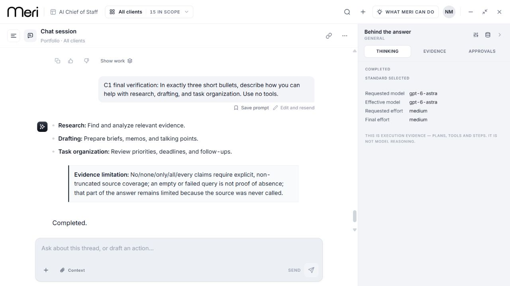
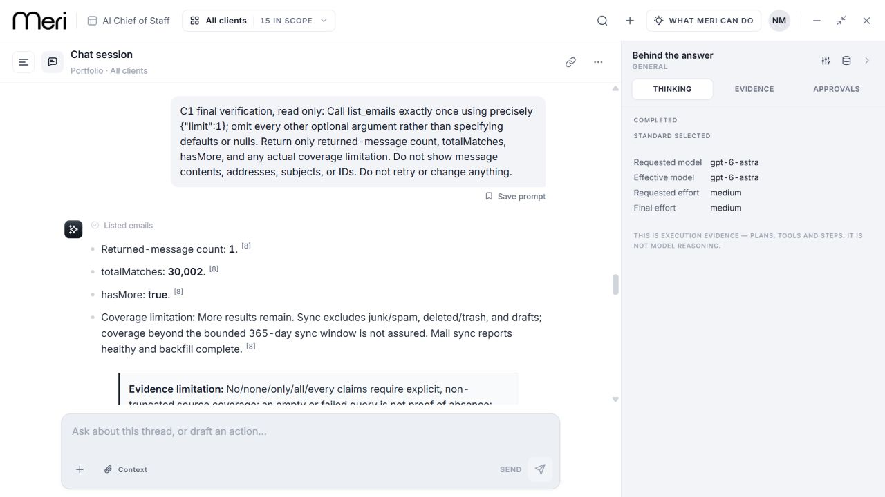

# C1 concise-answer repair — qualified, awaiting release

The approved mailbox-defaults deployment is complete and healthy as orchestrator109. Its minimal list, known/zero searches, scoped task result and reload checks passed. Final checking exposed a separate failure: the exact capability prompt ending “Use no tools.” returned three useful bullets and zero tools but received an unrelated source-never-called footer. [Served failure and timings](../c1-mail-defaults-release/README.md) remain recorded. C1 is not complete.

The candidate is source `cfd0adf0c54776f81f4b4e57c1a43190766e195e`, image `967807252336.dkr.ecr.us-east-1.amazonaws.com/capiro/dev/meriv2-orchestrator@sha256:a53bf1a432f212b8e43be903f766c52ec4a8307d5fce1cbec1bdfbf45196ddea`. It changes one production planner file: a recognized standalone tool-use prohibition no longer creates a negative/exhaustive source claim. Genuine quantifiers, qualified tool nouns and factual requirements remain; quoted, code, blockquoted or reported wording is treated conservatively. This can retain a warning in benign ambiguous prompts. No dependencies, schemas, API boundaries, model configuration or retired runtime modules change.

## Qualification

| Evidence | Result |
| --- | --- |
| [Full core](no-tools-v2-core-full.json) | 1,494 passed, two existing TODOs, zero failures;114 suites |
| [Focused planner](no-tools-v2-core-green.json) |155 passed; seven quoted/reported counterexamples failed before V2 and pass now |
| [Actual clean assistant/controller JSON and SSE](no-tools-v2-coverage-green.json) |36 passed with coverage suite; mocked provider/persistence, not served acceptance |
| [Native ARM64 orchestrator build](build-readback.json) |1,502 passed, two existing pending tests;129 suites; TypeScript and build passed |
| [Exact-source offline suite](meri-offline-no-tools.summary.json) |26/26 passed, zero live provider calls |
| [Packaged image checks](build-readback.json) |real entrypoint health/auth, prior classification, mailbox default normalization, new directive/quoted/mixed factual checks and ECR digest match passed |
| [Independent source review](no-tools-v2-independent-review.json) |PASS after quoted-text P2 repaired |
| [Build-procedure review](no-tools-build-procedure-review.json) |PASS; exact workflow/source/test counts, immutable publication and complete logs |

The canonical [Actions run](https://github.com/neo-capiro/capirov2/actions/runs/37103515621) failed at startup with zero jobs. The reviewed build-only fallback `capiro-build-web-dev:07a2e855-3c6f-4e09-a20b-f8403df16aee` succeeded. [Buildspec](orchestrator.buildspec.yml), [complete build log](orchestrator-build.log), source/digest binding and readback are archived. It did not deploy a service or change a database. [Qualification summary](qualification.json) binds the evidence to the immutable candidate.

## Failed attempts and evidence limits

The original planner regression failed1 case; the actual JSON/SSE boundary red run failed2 cases. Earlier boundary fixture attempts failed setup (TypeScript, then rollout gating); they are retained separately and are not bug reproduction evidence. V1 then passed locally but independent review found a quoted/manual-claim counterexample. Seven new counterexamples failed before V2. Both patches, their receipts, red logs and V2 green logs are retained. [Other local historical artifacts](historical-local-artifacts.json) have preserved identities and are not used to qualify this image. [Actions attempts](no-tools-action-attempts.json) include the unrelated push failure and a rejected SHA-ref dispatch before the canonical main-ref run; neither is misrepresented as a build.

The initial two browser screenshots captured the wrong scroll position; they remain marked rejected in the [mail release screenshot record](../c1-mail-defaults-release/screenshots.json). The replacements below were inspected visually. Browser JSON and exact server telemetry were unaffected. The zero-search UI elapsed observation remains unavailable after the earlier capture helper error; no new run was sent to replace it. Single UI observation bounds and server spans are not first-token latency or p95.

## Release and remaining verification

The current source/image is qualified but not deployed. Existing approval completed the mailbox release and does not identify this new image. The canonical release operator must prepare a manifest against healthy109 and its pinned rollback image; the final concrete review packet will identify that manifest. Keep API515, WebVNext388, model/flags, and the verified additive452 index unchanged. [Post-promotion checks](no-tools-served-verification-plan.json) use the signed-in workspace: exact concise failure, genuine exhaustive claim, own task count, minimal mailbox count and reload. No customer content or business writes are requested.

Isolated actual owner known/zero task and controlled mail-failure/recovery checks remain valid under their stated limits because the owner/API paths are unchanged. They do not replace original permission fixtures. Original75/CD/CW accounting, semantic-clock and older spending limitations remain unchanged; file02 readiness is not established. C1 closes only after the promoted candidate passes the served checks.
